# Dossier d'architecture : plateforme RÉSULTATS-BF

Université Joseph Ki Zerbo, IBAM. Master 1 Informatique, module DevOps et infrastructures reproductibles. Enseignant : Dr SOMDA. Projet de groupe, année universitaire 2026-2027.

Groupe 13 (réseau privé n° 5) : OUEDRAOGO Adama, TEGA Paamda Sawratou Lareine, TINDANO Fernand Amed, KABORE Nongdo Valery Ariel. Date : 27/10/2026. Dépôt : https://github.com/ADAMS-DEVTECH/resultats-bf

## 1. Contexte et exigences

### 1.1 Le cas

Chaque année, la publication des résultats d'examens fait tomber le site dans les dix minutes qui suivent l'annonce. Le problème vient rarement du programme : c'est l'infrastructure qui n'a été pensée ni pour absorber un pic de consultations, ni pour survivre à la panne d'une machine. Notre groupe construit la plateforme RÉSULTATS-BF, qui permet à un candidat de consulter son résultat à partir de son matricule.

Deux exigences non fonctionnelles priment sur tout le reste :
- **résilience** : la panne d'une machine ne doit pas interrompre le service ;
- **scalabilité** : absorber plus de trafic doit se faire en ajoutant des machines, sans réécrire la configuration.

Une contrainte transversale s'y ajoute : toute l'infrastructure est décrite en code et se reconstruit sur n'importe quel poste sans geste manuel (Vagrant et VirtualBox, boîte `bento/ubuntu-24.04` épinglée à la version `202404.26.0`, aucune ressource payante).

### 1.2 Périmètre réalisé

| Élément | État |
|---------|------|
| Socle obligatoire (R1 à R8) : base primaire, réplique, N serveurs applicatifs, répartiteur | Réalisé |
| E1 : second répartiteur et adresse IP virtuelle (VRRP) | Réalisée |
| E2 : Prometheus, node_exporter et Grafana | Réalisée |
| E3 (cache Redis), E4 (déploiement sans coupure) | Non réalisées (deux extensions suffisent) |

### 1.3 Équipe et rôles

| Rôle | Membre | Réalisations |
|------|--------|--------------|
| Architecte réseau et répartition | OUEDRAOGO Adama | Plan d'adressage, Vagrantfile, HAProxy, sonde de santé, E1, V1, V2, V6 |
| Ingénieur applicatif | TEGA Paamda Sawratou Lareine | Tests de l'application (400, 404, 503), absence d'état, secrets |
| Ingénieur données | TINDANO Fernand Amed | PostgreSQL, réplication, bascule (V4), procédure de bascule |
| Ingénieur essais et observabilité | KABORE Nongdo Valery Ariel | Rôle assuré par Adama : V3, V5, E2 et rédaction des résultats |

## 2. Architecture et justification des choix

### 2.1 Vue d'ensemble

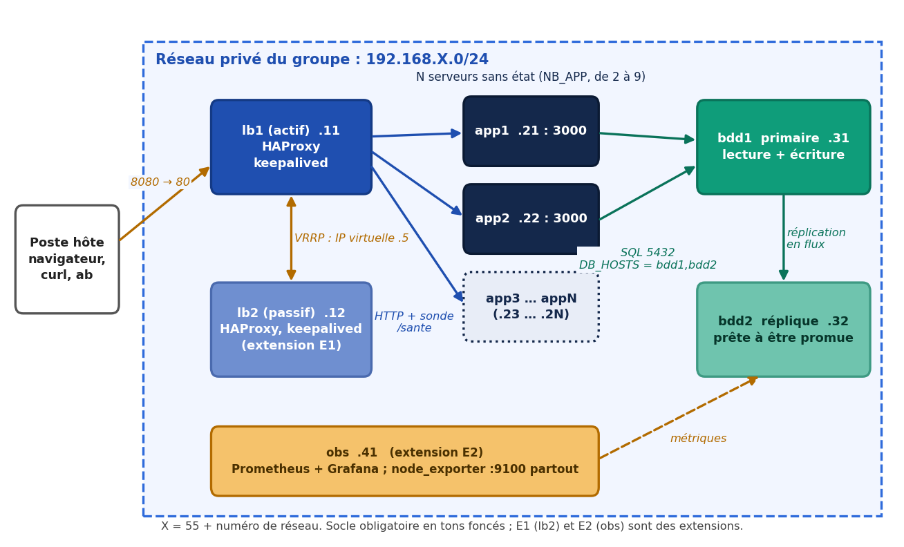

Un candidat interroge le répartiteur (lb1), qui distribue les requêtes sur N serveurs applicatifs sans état. Chaque serveur lit les résultats dans la base primaire (bdd1), répliquée en flux sur bdd2. Le répartiteur n'envoie du trafic qu'aux serveurs dont la sonde `/sante` répond 200, c'est-à-dire dont la base répond. Un second répartiteur (lb2) et une machine d'observation (obs) complètent le dispositif.

| Machine | Rôle | Adresse | RAM | Statut |
|---------|------|---------|-----|--------|
| bdd1 | PostgreSQL primaire, lecture et écriture | .31 | 768 Mo | Obligatoire |
| bdd2 | Réplique en flux, promouvable | .32 | 768 Mo | Obligatoire |
| app1 … appN | Serveurs applicatifs sans état (2 ≤ N ≤ 9) | .21 … .2N | 512 Mo | Obligatoire |
| lb1 | Répartiteur actif (HAProxy, keepalived) | .11 | 512 Mo | Obligatoire |
| lb2 | Répartiteur passif | .12 | 512 Mo | Extension E1 |
| obs | Prometheus et Grafana | .41 | 768 Mo | Extension E2 |

Le socle représente cinq machines virtuelles et environ 3,1 Go de mémoire, ce qui tient sur un poste de 8 Go.

### 2.2 Choix techniques et raisons

| Choix | Raison | Alternative écartée |
|-------|--------|---------------------|
| Vagrant et scripts shell, un script par rôle | Imposé par le sujet ; pas d'outil supplémentaire à installer sur les postes des quatre membres ; scripts lisibles et relisibles | Ansible : puissant mais une dépendance de plus sous Windows |
| Source unique de vérité : `config/noeuds.yml`, engendré par le Vagrantfile | Les machines, la configuration de HAProxy et les cibles de Prometheus dérivent de la même table : ajouter un serveur ne demande qu'un changement (R3) | Écrire les adresses des serveurs dans `haproxy.cfg` (interdit, −2 points) |
| HAProxy, répartition `roundrobin`, sonde HTTP `GET /sante` toutes les secondes, deux échecs pour retirer un serveur (`inter 1s fall 2`), `option redispatch` | Détection en quelques secondes ; les requêtes en cours sont rejouées sur un autre serveur | Sonde TCP seule : un serveur dont la base est tombée resterait dans le service |
| `/sante` interroge la base et renvoie 503 sinon | La sonde reflète la vraie disponibilité du service, pas seulement celle du processus | Sonde qui renvoie toujours 200 (interdit par le sujet) |
| Application sans état : une connexion à la base par requête, rien en local | Ajouter ou retirer un serveur est indolore | Pool de connexions : plus rapide, mais non retenu faute de temps (voir §9) |
| PostgreSQL avec réplication en flux asynchrone, bdd2 en `hot_standby` | Solution native, simple, éprouvée ; bdd2 est une copie exacte de bdd1 créée par `pg_basebackup` | Réplication logique : plus souple mais inutile ici ; réplication synchrone : latence d'écriture |
| `DB_HOSTS = bdd1,bdd2` avec `target_session_attrs = read-write` | Après promotion de bdd2, les applications retrouvent une base accessible en écriture sans reconfiguration | Changer l'adresse de la base dans chaque application à la main |
| Bascule manuelle (`scripts/bascule.sh`) | Évite que deux bases se croient primaires en même temps (split-brain) ; le script refuse si bdd1 tourne encore | Promotion automatique : hors périmètre |
| Secrets dans `.env` (ignoré par Git), `.env.exemple` versionné ; transmis par variables d'environnement ; fichiers à droits 600 dans les machines | Aucun mot de passe dans l'historique (R7) | Mots de passe dans les scripts |
| Réseau privé hôte-seul ; seul lb1 expose un port vers l'hôte (8080 vers 80) | R8 : tout le trafic interne reste sur le réseau privé | Redirections de ports multiples |
| keepalived en VRRP, mode unicast, sonde `systemctl is-active haproxy` | Adresse virtuelle partagée entre lb1 et lb2 (E1) | Multicast : moins fiable sur un réseau hôte-seul |
| Prometheus, node_exporter sur chaque machine, Grafana | Mesure objective de la charge et des pannes (E2) | Supervision à la main avec `curl` |

### 2.3 Points de défaillance uniques

| Composant | Risque | Parade | Résultat mesuré |
|-----------|--------|--------|-----------------|
| Serveur applicatif | Panne d'une machine | N ≥ 2 serveurs, sonde `/sante`, `option redispatch` | 0 requête perdue, détection en 1,6 s |
| Répartiteur | Panne de lb1 | lb2, keepalived, adresse virtuelle (E1) | Reprise en 3,9 s (coupure brutale) |
| Base de données | Panne de bdd1 | Réplique bdd2 et procédure de bascule | 503 propre, bascule en 24,4 s et 26,4 s |
| Poste hôte | Panne du PC | Non traitable : toutes les machines sont sur le même ordinateur | Limite reconnue |
| Supervision | Panne d'obs | Aucune : obs ne participe pas au service | Sans impact sur le service |

### 2.4 Scalabilité

Passer de 2 à 4 serveurs applicatifs se fait en changeant `NB_APP` dans `.env`, puis `vagrant up` : le Vagrantfile crée les machines manquantes, régénère `noeuds.yml`, et le script `lb-config.sh` (exécuté à chaque démarrage) reconstruit `haproxy.cfg`. Une limite physique s'applique : les machines se partagent le processeur d'un seul ordinateur, et le goulet d'étranglement est la base, unique en écriture et en lecture dans notre architecture. Ajouter des serveurs applicatifs ne fait donc pas augmenter indéfiniment le débit (voir §6, V3).

## 3. Plan d'adressage

Le sujet impose le sous-réseau 192.168.X.0/24 avec X = 55 + G, G étant compris entre 1 et 8, car VirtualBox n'autorise par défaut que la plage 192.168.56.0/21. Le groupe 13 dépasse cette plage : il utilise le **réseau n° 5**, soit 192.168.60.0/24 (modifier `networks.conf` est interdit, car cela rendrait le dépôt non reproductible).

| Adresse | Rôle |
|---------|------|
| 192.168.60.1 | Poste hôte (adaptateur hôte-seul) |
| 192.168.60.5 | Adresse virtuelle VRRP (E1) |
| 192.168.60.11 et .12 | lb1 et lb2 |
| 192.168.60.21 à .29 | Serveurs applicatifs app1 à app9 (port 3000) |
| 192.168.60.31 et .32 | bdd1 et bdd2 (port 5432) |
| 192.168.60.41 | obs (Prometheus 9090, Grafana 3000) |

Ports : 80 (HAProxy, redirigé vers 8080 sur l'hôte), 8404 (statistiques HAProxy), 3000 (application), 5432 (PostgreSQL), 9100 (node_exporter), 9090 et 3000 (obs).

## 4. Mise en œuvre

### 4.1 Contenu du dépôt

| Élément | Rôle |
|---------|------|
| `Vagrantfile` | Lit `.env`, construit la liste des machines, écrit `config/noeuds.yml`, lance un script par rôle |
| `scripts/lib.sh` | Fonctions communes (DNS, apt en IPv4, configuration PostgreSQL) |
| `scripts/bdd.sh`, `replique.sh` | Primaire (rôles, base, 50 000 lignes) et réplique (`pg_basebackup`) |
| `scripts/app.sh`, `app/app.py` | Service systemd et application (moins de 100 lignes) |
| `scripts/lb.sh`, `lb-config.sh` | Installation, puis configuration de HAProxy et de keepalived générée depuis `noeuds.yml` |
| `scripts/obs.sh`, `obs-config.sh` | Installation de Prometheus et Grafana, cibles générées |
| `scripts/bascule.sh` | Promotion de bdd2 et chronométrage |
| `tests/` | Scénarios V1 à V6 et diagnostics |
| `docs/` | Dossier, procédure de bascule, résultats, journal de bord |

### 4.2 Application

L'application expose trois routes : `/resultat?matricule=…` (résultat lu dans la base, 400 sans matricule, 404 si inconnu), `/sante` (200 si la base répond, 503 sinon) et `/info` (nom de la machine qui répond). Elle écoute sur `0.0.0.0`, ne garde ni session, ni fichier, ni compteur, et répond toujours en JSON, y compris en cas de panne de la base.

### 4.3 Idempotence

Tous les scripts peuvent être rejoués : les fichiers de configuration sont réécrits en entier ou n'ajoutent un bloc que s'il est absent (`grep -q`) ; les rôles et la table PostgreSQL ne sont créés que s'ils manquent ; HAProxy n'est rechargé que si la configuration a changé ; la réplique n'est initialisée qu'une fois (fichier marqueur), pour qu'un rejeu après une bascule n'écrase pas la nouvelle primaire.

### 4.4 Pièges évités

Services en écoute sur `0.0.0.0` et non `127.0.0.1` ; `.gitattributes` imposant des fins de ligne LF ; données PostgreSQL hors du dossier synchronisé ; base déclarée avant les applications, et application qui ne se connecte à la base qu'à la première requête (donc tolérante à une base absente au démarrage) ; configuration du répartiteur générée, jamais écrite à la main.

## 5. Procédures d'exploitation

### 5.1 Premier démarrage

```
git clone https://github.com/ADAMS-DEVTECH/resultats-bf.git
cd resultats-bf
copy .env.exemple .env      (ou cp sous Git Bash)
vagrant up
curl http://localhost:8080/info
```
Dans `.env`, `GROUPE` est compris entre 1 et 8 et les mots de passe ne contiennent pas d'apostrophe. La première construction prend 10 à 25 minutes.

### 5.2 Ajouter des serveurs applicatifs

Modifier `NB_APP` dans `.env` (par exemple 4), puis `vagrant up`. Vérifier avec `bash tests/v1-repartition.sh`. Pour revenir à 2 serveurs, supprimer d'abord les machines en trop avec la même valeur de `NB_APP` (`vagrant destroy -f app3 app4`), puis rediminuer `NB_APP` : sinon `vagrant destroy` oublierait les machines retirées du Vagrantfile.

### 5.3 Basculer la base de données

La bascule est irréversible : après promotion de bdd2, seule une reconstruction complète remet la plateforme à neuf.
1. `vagrant halt bdd1` (la panne).
2. `bash scripts/bascule.sh` : le script vérifie que bdd2 tourne et que bdd1 est arrêtée, promeut bdd2 (`pg_promote`) puis attend que `/sante` renvoie 200 (60 s maximum, sinon échec explicite).
3. Contrôles : `pg_is_in_recovery()` vaut `f` sur bdd2, une écriture réussit, `/resultat` répond 200.

Détails, sorties brutes et limites : `docs/procedure-bascule.md`.

### 5.4 Activer les extensions

- **E1** : `E1_LB2=1` dans `.env`, puis `vagrant up` et `vagrant provision lb1` (lb1 existe déjà). L'adresse virtuelle est `192.168.X.5`.
- **E2** : `E2_OBS=1`, puis `vagrant up`. Grafana : `http://192.168.X.41:3000` (utilisateur `admin`, mot de passe `GRAFANA_ADMIN_PASSWORD`), tableau « RESULTATS-BF ». Prometheus répond sur le port 9090 (`/-/healthy`, `/api/v1/targets`).

Garder les mêmes valeurs dans `.env` pendant toute la vie de la plateforme, jusqu'au `vagrant destroy`.

### 5.5 Reconstruire et dépanner

`vagrant destroy -f` puis `vagrant up` reconstruit tout sans intervention. Les incidents réels rencontrés et leurs remèdes sont dans la section « Dépannage » du `README.md`.

## 6. Résultats des scénarios de validation

Le détail (commandes exactes, sorties brutes, commentaires) est dans `docs/modele-resultats.md`. Poste de mesure : PC d'Adama, Windows, VirtualBox 7.2, une machine virtuelle à 1 processeur chacune.

| Scénario | Résultat | Mesure |
|----------|----------|--------|
| V1 Répartition | Conforme | 10 et 10 avec 2 serveurs ; 5, 5, 5, 5 avec 4 serveurs ; écart 0 % |
| V2 Panne d'un serveur applicatif | Conforme | 0 requête perdue sur 59 et 32 ; détection en 1,6 s |
| V3 Montée en charge | **Non concluant** | 97 à 99 % de réponses non 2xx |
| V4 Panne de la base primaire | Conforme | 503 propre ; bascule en 24,4 s et 26,4 s |
| V5 Reconstruction | Conforme | 1421 s (23 min 41 s) |
| V6 Panne du répartiteur (E1) | Conforme | 3,9 s (coupure brutale) |

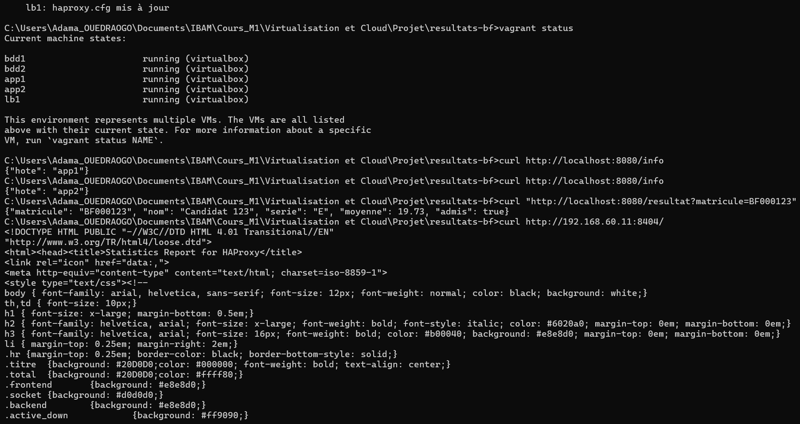

### 6.1 V1 et V2 : répartition et panne d'un serveur

Avec `roundrobin`, 20 appels se répartissent exactement à parts égales (écart 0 %), avec 2 comme avec 4 serveurs ; le passage à 4 s'est fait en changeant la seule valeur `NB_APP`.

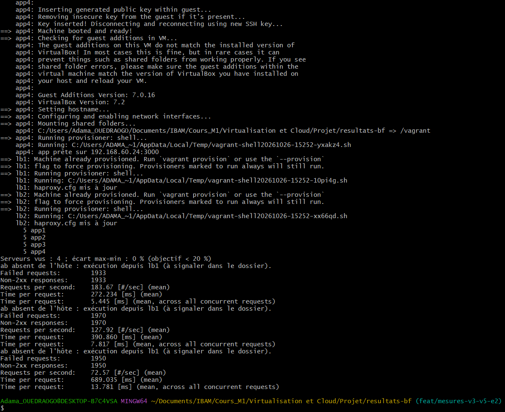

Pendant `vagrant halt app1`, aucune requête n'est perdue : la sonde retire app1 en 1,6 s, et les requêtes en cours sont rejouées sur app2. La mesure est limitée : `curl` lancé en boucle sous Windows ne produit que 1,5 à 2,5 requêtes par seconde, et une coupure de moins d'une demi-seconde pourrait passer inaperçue. Dans un essai fait juste après V3, trois erreurs sont apparues, mais avant la panne : elles viennent de la charge résiduelle, pas de l'arrêt du serveur.

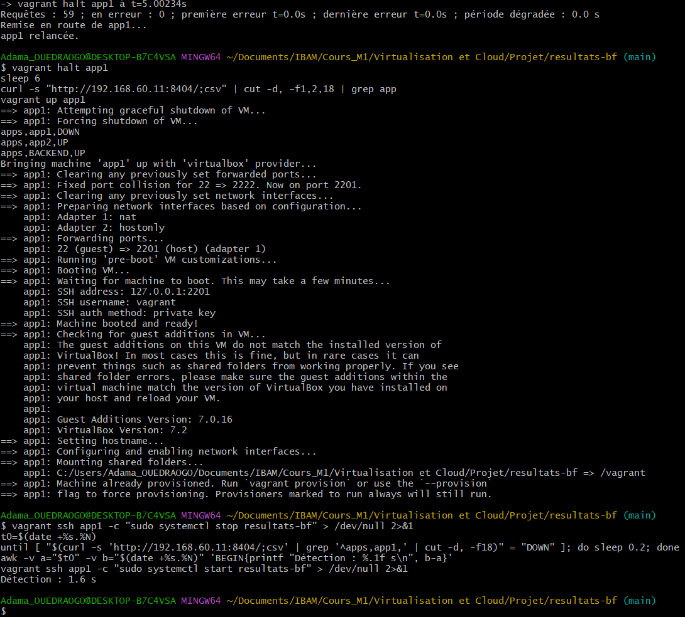

### 6.2 V3 : montée en charge (résultat non concluant)

Nous avons lancé `ab -n 2000 -c 50` sept fois (2 serveurs, 4 serveurs, 4 serveurs avec E2). Les débits affichés vont de 72 à 184 requêtes par seconde, mais **de 96,7 à 98,7 % des réponses étaient des erreurs** (« Non-2xx responses »). Ces chiffres mesurent donc surtout des réponses d'erreur rendues vite, pas des lectures réussies : nous ne les présentons pas comme un débit du service. Deux indices le confirment : le débit baisse d'un essai à l'autre dans une même configuration (128, 91, 73 avec 2 serveurs), ce qui est un effet d'ordre, et le dernier essai de chaque série donne presque la même valeur quelle que soit la configuration (72,6 ; 72,6 ; 74,3 req/s). Le tableau de bord Grafana montre pendant la charge des processeurs à 100 % : la plateforme était saturée.

Nous attribuons cette saturation, sous réserve de vérification, à la base : chaque requête ouvre une connexion PostgreSQL authentifiée sur une machine à un seul processeur, des connexions dépassent le délai de 2 s de l'application (réponse 503), les sondes `/sante` échouent à leur tour et HAProxy répond lui-même par des 503. Lancer `ab` depuis lb1 (faute d'`ab` sous Windows) consomme en outre son processeur.

Pour trancher, le dépôt contient désormais `tests/v3-diagnostic.sh` (débit et pourcentage d'erreurs à concurrence 1, 5, 10, 20 puis 50, plus les compteurs 2xx et 5xx de HAProxy), et `tests/v3-charge.sh` signale tout seul une mesure non valide. La conclusion honnête de cette étape est que, sur un poste où toutes les machines se partagent un processeur, la base est le goulet d'étranglement, et que le nombre de serveurs applicatifs n'est pas le facteur limitant. Il reste à refaire V3 dans des conditions valides.

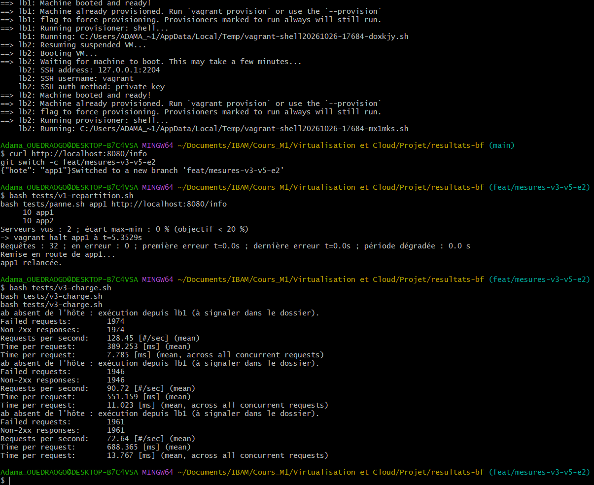

### 6.3 V4 : panne de la base primaire

Quand bdd1 est arrêtée, le répartiteur renvoie un 503 propre (page de HAProxy, jamais une page blanche). `scripts/bascule.sh` promeut bdd2 : le service revient en **24,4 s** (essai 1) puis **26,4 s** (essai 2, après reconstruction), bdd2 n'est plus en recovery et accepte les écritures, et `/resultat` répond de nouveau 200 sans toucher aux applications. L'essai a été fait par l'ingénieur données dans Git Bash ; des essais précédents lancés depuis l'invite de commandes Windows (`vagrant: command not found`, `HTTP 000`) ont été écartés.

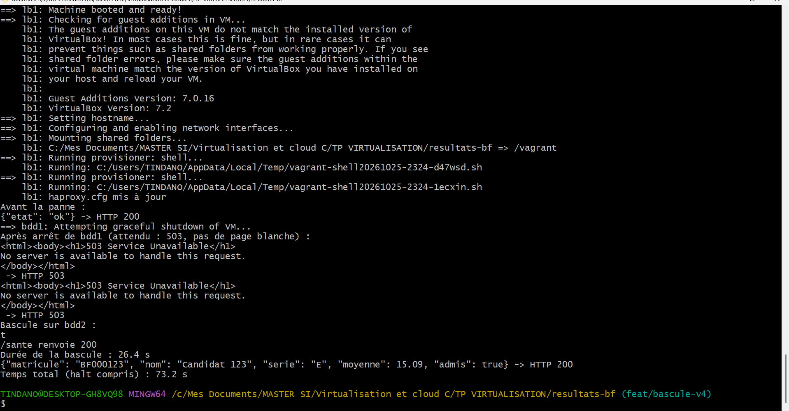

La réplication elle-même est confirmée par `pg_stat_replication` (état `streaming`).

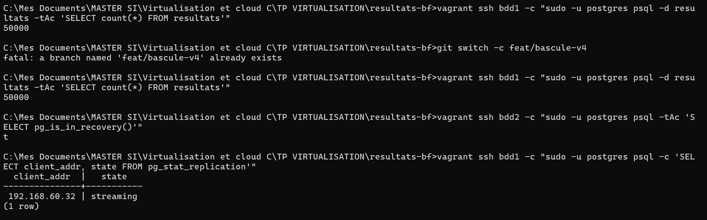

### 6.4 V5 et V6

La plateforme complète se reconstruit sans aucun geste manuel en **1421 s** (R1). Avec E1, lb2 reprend l'adresse virtuelle en **3,9 s** après une coupure brutale de lb1, et sans perte de requête lors d'un arrêt propre.

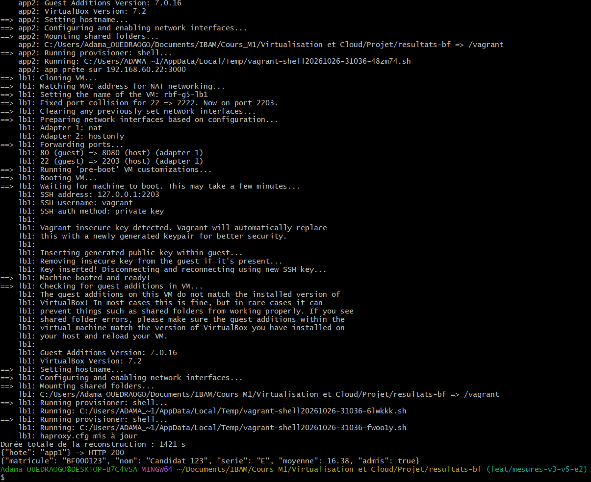

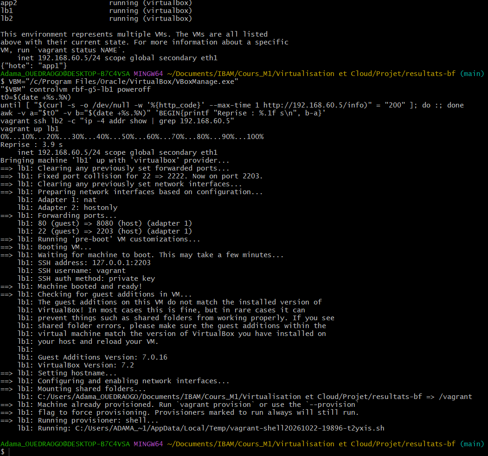

### 6.5 Conformité aux exigences obligatoires

| Exigence | Preuve | État |
|----------|--------|------|
| R1 Reconstruction intégrale | V5 : 1421 s, sans geste manuel | Conforme |
| R2 Idempotence | `md5sum` de `haproxy.cfg` identique après deux `vagrant provision` ; `pg_hba` : un seul bloc ; 50 000 lignes inchangées | Conforme |
| R3 Nombre de serveurs paramétrable | `NB_APP=4` : V1 donne 5, 5, 5, 5 ; configuration de HAProxy régénérée | Conforme |
| R4 Sonde de santé | Retrait d'un serveur en 1,6 s | Conforme |
| R5 Réplication | `streaming` ; ligne écrite sur bdd1 relue sur bdd2 | Conforme |
| R6 Bascule écrite, exécutable et chronométrée | `scripts/bascule.sh` ; 24,4 s et 26,4 s | Conforme |
| R7 Aucun secret dans l'historique | `git log -p` ne montre que des valeurs factices ; `.env` ignoré | Conforme (vérifier une dernière fois avant le rendu) |
| R8 Un seul port exposé | Seul lb1 redirige un port (8080) vers l'hôte | Conforme |

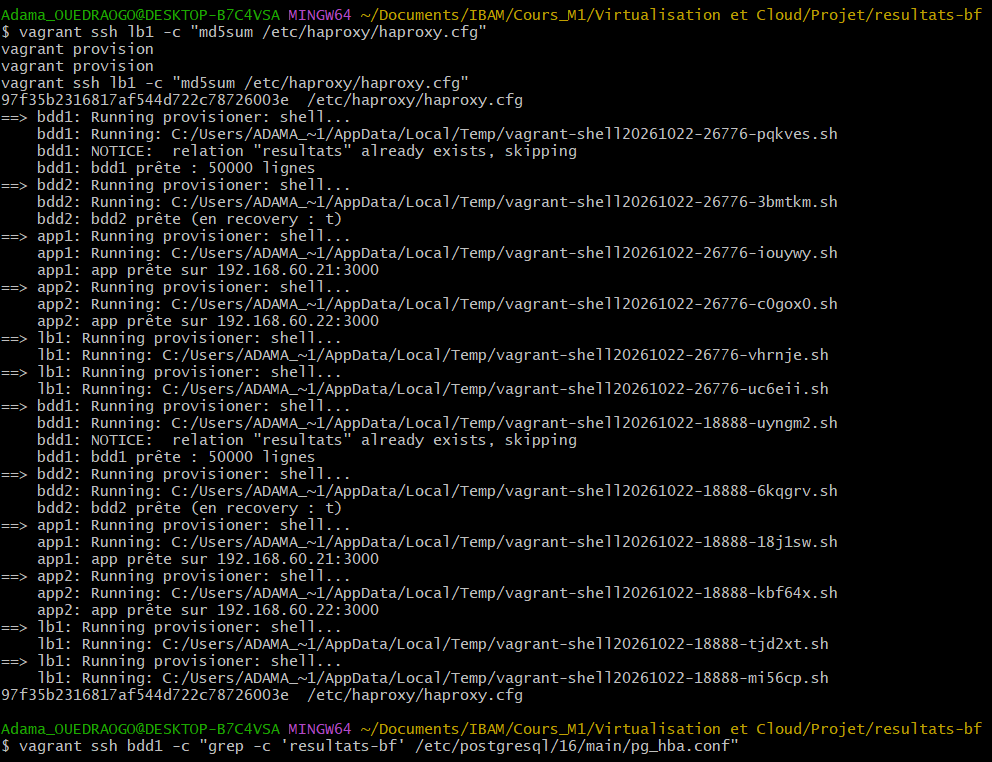

## 7. Extensions

### 7.1 E1 : répartiteur redondant

lb2 reçoit la même configuration HAProxy (générée depuis `noeuds.yml`) et partage avec lb1 l'adresse virtuelle `192.168.X.5` grâce à keepalived (VRRP en unicast ; priorité 150 pour lb1, 100 pour lb2 ; annonces toutes les secondes). Une sonde vérifie que HAProxy tourne : si HAProxy s'arrête sur lb1, l'adresse passe à lb2.

**Incident** : l'adresse n'apparaissait sur aucun répartiteur. Le journal de keepalived répétait `killall5: usage` : sous Ubuntu 24.04, `pidof` est un lien vers `killall5`, et la sonde échouait à chaque seconde, ce qui laissait les deux nœuds en panne. Nous l'avons remplacée par `systemctl is-active --quiet haproxy`. **Résultat** : reprise en 3,9 s après coupure brutale ; aucune requête perdue lors d'un arrêt propre.

### 7.2 E2 : observabilité

Prometheus (collecte toutes les 5 s) et node_exporter sur chaque machine ; Grafana avec une source de données et un tableau de bord fournis par le dépôt (machines vivantes, débit réseau entrant, CPU). Les cibles de Prometheus sont générées depuis `noeuds.yml` à chaque `vagrant up`. Contrôles : `Prometheus Server is Healthy`, sept cibles `up`, `/api/health` de Grafana à 200.

Pendant la charge de V3, le tableau de bord montre un pic de débit et des processeurs saturés, et pendant la panne d'app1, la courbe « Machines vivantes » de la machine tombe à 0 : c'est ce que l'extension devait démontrer.

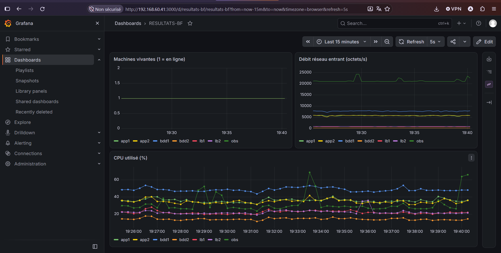

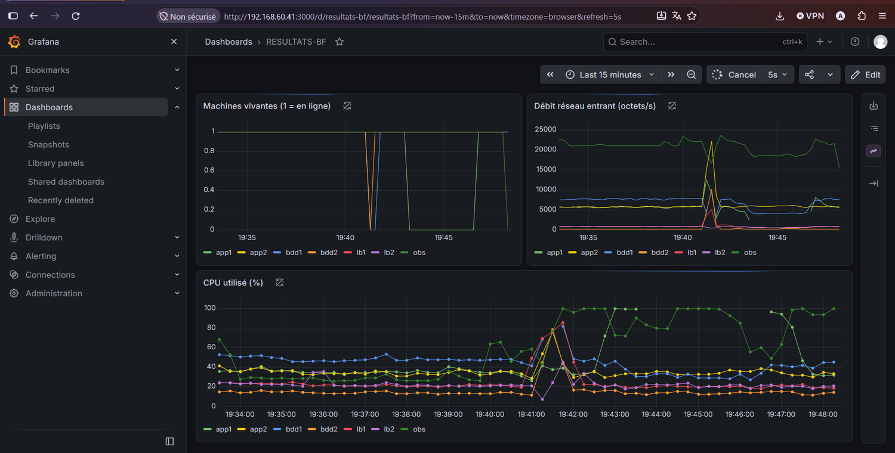

**Incident** : Grafana plantait en boucle (`read-only file system` sur sa base SQLite). Notre script écrasait `/etc/default/grafana-server` avec une seule variable, ce qui supprimait les chemins de données du paquet. Nous l'avons corrigé (fichier recréé avec toutes les valeurs d'origine, mot de passe passé par un fichier systemd à droits 600) et le script attend désormais que Grafana réponde avant de réussir.

### 7.3 Extensions non réalisées

E3 (cache Redis) et E4 (déploiement sans coupure) n'ont pas été traitées : deux extensions étaient exigées, et le temps a été consacré aux mesures et à la fiabilité des scripts.

## 8. Organisation et qualité

- **Dépôt Git** : branches par tâche, pull requests relues par un autre membre, messages de commit au format `type(portée): résumé` (voir `CONTRIBUTING.md`). Trois pull requests ont été fusionnées au moment de la rédaction ; l'historique montre les contributions de plusieurs membres.
- **Rotation** : le sujet exige un commit significatif hors de son domaine pour chaque membre. Exemples réalisés : l'ingénieur applicatif a ajouté deux garde-fous à `bascule.sh` (fichier de l'ingénieur données, pull request n° 2) ; l'architecte réseau a modifié `bdd.sh` pour fixer la graine des données (commit `2bd83e4`). _Compléter avec les commits hors domaine des autres membres avant le rendu._
- **Reproductibilité** : la reconstruction complète a été faite sur plusieurs postes (Adama, Lareine, Fernand), chacun avec son propre `.env`. Un défaut a été découvert ainsi : les données changeaient à chaque reconstruction (`random()`), corrigé par `SELECT setseed(0.42);` ; après correction, `BF000123` vaut 16,38 de façon reproductible.
- **Mesurer plutôt qu'affirmer** : plusieurs de nos propres mesures se sont révélées invalides (scripts lancés depuis l'invite de commandes Windows, V3 à 98 % d'erreurs) ; nous les avons signalées plutôt que présentées comme des résultats.

Incidents notables, résumés : version de boîte de l'Annexe A introuvable (remplacée par `202404.26.0`) ; DNS instable des machines (DNS publics ajoutés dans `lib.sh`) ; accès IPv6 d'`apt` (IPv4 forcé) ; fichier de test vide à 0 octet après décompression ; `pidof` et keepalived ; Grafana et son fichier de configuration. Le détail figure dans le journal de bord et dans la section « Dépannage » du `README.md`.

## 9. Limites connues et ce que nous ferions autrement

| Limite | Conséquence | Ce que nous ferions autrement |
|--------|-------------|-------------------------------|
| V3 non concluant | Aucune conclusion chiffrée sur la scalabilité | Diagnostiquer avec `tests/v3-diagnostic.sh`, puis refaire V3 ; ajouter un pool de connexions dans l'application pour supprimer le coût d'une connexion par requête |
| Un seul poste, un processeur partagé | Le nombre de serveurs applicatifs n'est pas le facteur limitant ; la base l'est | Répartir sur plusieurs postes, ou donner plus de processeurs à bdd1 |
| bdd1 non remise en réplique après la bascule | La plateforme n'est plus redondante | Automatiser la reconstruction de l'ancienne primaire en réplique |
| Bascule de 24 à 26 s, durée non décomposée | Part de `vagrant ssh`, de la promotion et du rétablissement des sondes inconnue | Chronométrer chaque étape |
| Réplication asynchrone | Perte possible des dernières transactions en cas de panne brutale (non mesurée) | Réplication synchrone, au prix de la latence |
| Bascule manuelle | Service indisponible jusqu'à l'intervention | Outil de bascule automatique (par exemple Patroni) |
| Ordre des hôtes dans `DB_HOSTS` | Tant que bdd1 est éteinte, chaque connexion attend son délai de 2 s avant d'utiliser bdd2 (non mesuré après la bascule) | Ré-ordonner l'adresse après la bascule ou placer un répartiteur de base |
| Mesures avec `curl` en boucle | Faible cadence (1,5 à 2,5 requêtes par seconde) | Utiliser un outil plus rapide qu'une boucle de `curl` |
| Mesures uniques ou en nombre limité | Valeurs de V6 et de la détection à répéter | Au moins trois essais par mesure, avec médiane |
| Machine obs juste en mémoire (768 Mo) | Swap utilisé avec Grafana | Passer à 1024 Mo |

## Annexe A. Reproduire la plateforme

```
git clone https://github.com/ADAMS-DEVTECH/resultats-bf.git
cd resultats-bf
cp .env.exemple .env        (puis éditer .env)
vagrant up
bash tests/v1-repartition.sh
bash tests/panne.sh app1 http://localhost:8080/info
bash tests/v3-diagnostic.sh
bash tests/v4-panne-bdd.sh
bash tests/v5-reconstruction.sh
```
Les scripts de `tests/` se lancent dans Git Bash.
