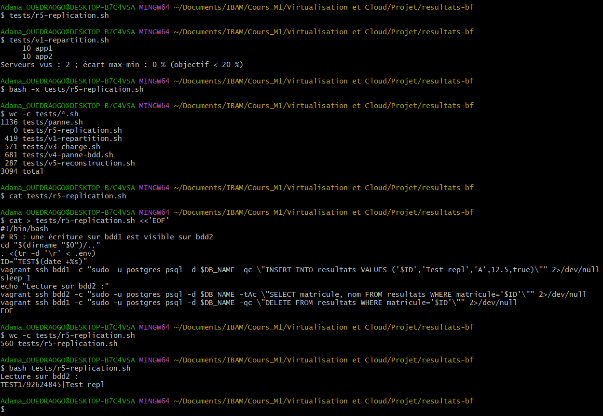
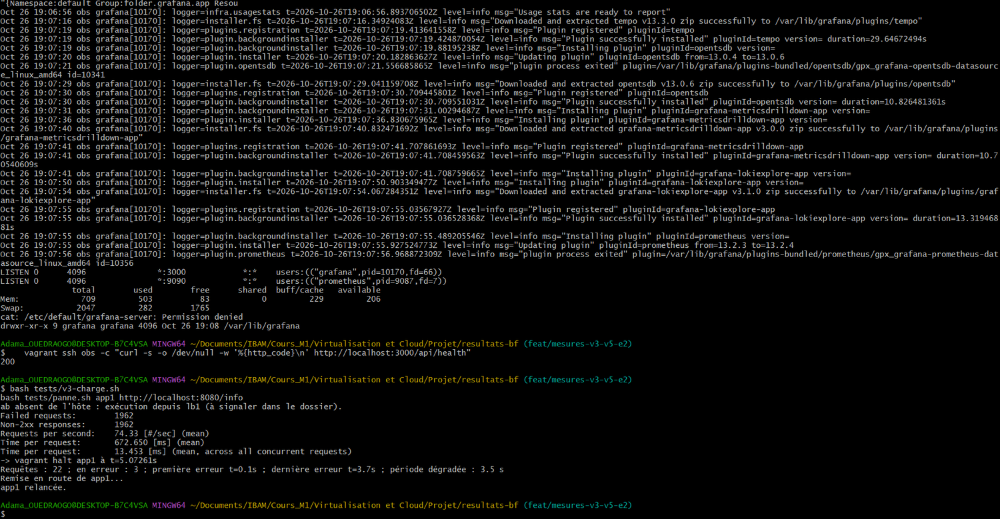
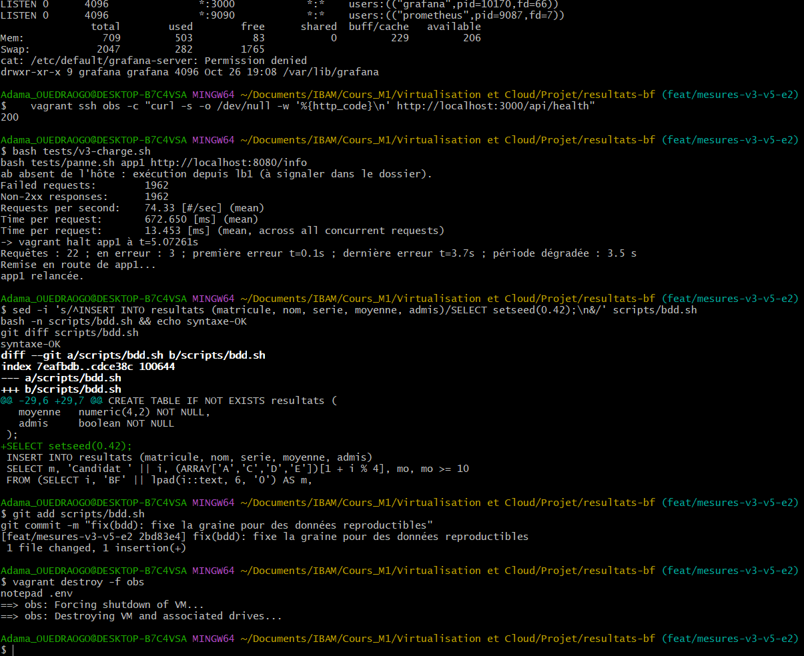
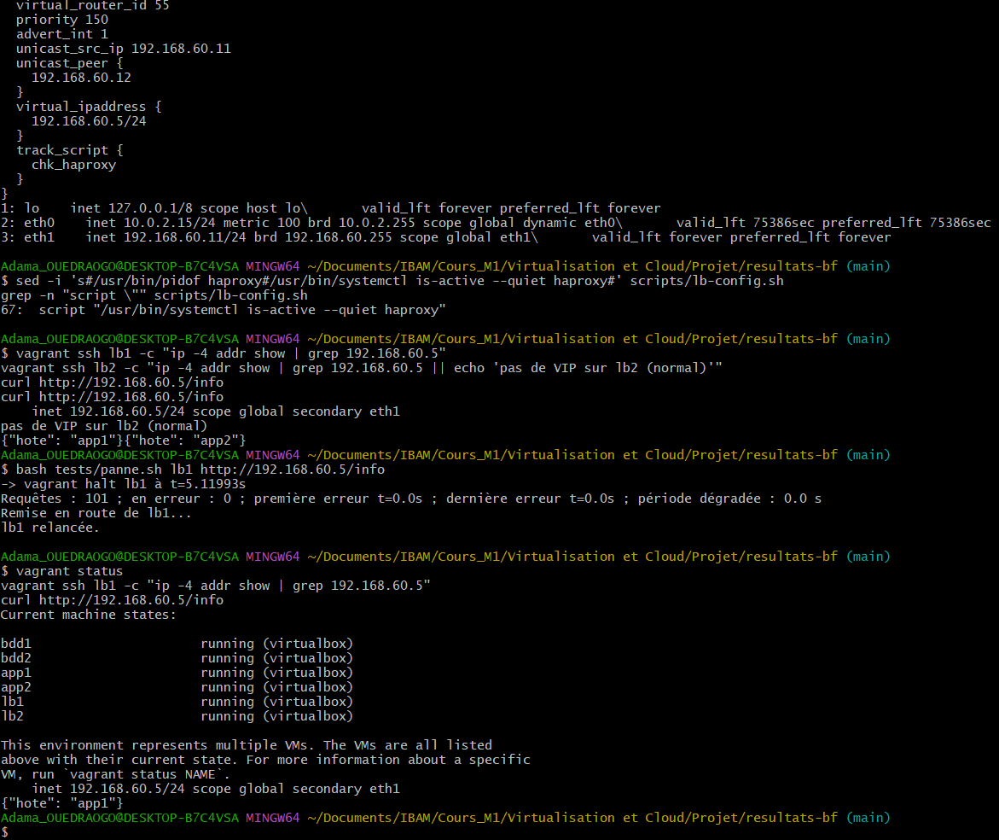
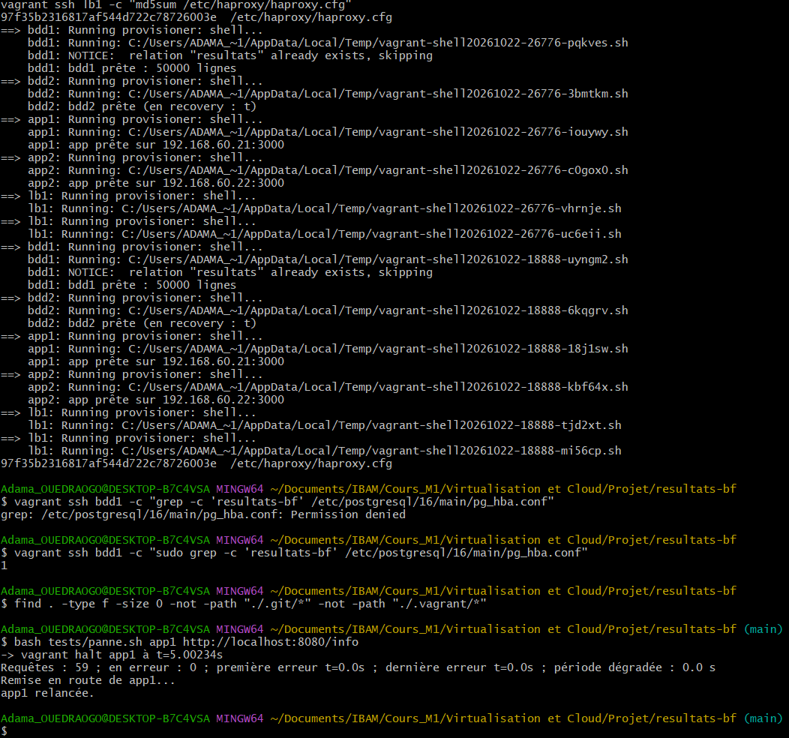

# Résultats des scénarios de validation (V1 à V6) et des extensions

Les sorties ci-dessous viennent des captures d'écran du projet, recopiées sans retouche. Poste de mesure : PC d'Adama (Windows, VirtualBox 7.2), une machine virtuelle à 1 processeur chacune, boîte `bento/ubuntu-24.04` version `202404.26.0`, réseau privé n° 5 (192.168.60.0/24). Processeur et mémoire de l'hôte : _à préciser_.

Résumé : V1, V2, V4, V5 et V6 sont conformes. **V3 n'est pas concluant** : 97 à 99 % des réponses y étaient des erreurs, donc les débits mesurés ne sont pas ceux du service (voir V3).

| Scénario | Résultat | Mesure principale |
|----------|----------|-------------------|
| V1 Répartition | Conforme | Écart 0 % avec 2 puis 4 serveurs |
| V2 Panne d'un serveur applicatif | Conforme | 0 requête perdue pendant la panne ; détection en 1,6 s |
| V3 Montée en charge | Non concluant | 97 à 99 % de réponses non 2xx |
| V4 Panne de la base primaire | Conforme | 503 propre ; bascule en 24,4 s et 26,4 s |
| V5 Reconstruction | Conforme | 1421 s (23 min 41 s) |
| V6 Panne du répartiteur (E1) | Conforme | Reprise en 3,9 s (coupure brutale) |

---

## V1. Répartition

Commande : `bash tests/v1-repartition.sh` (20 appels à `/info`).

Sortie brute, 2 serveurs :
```
     10 app1
     10 app2
Serveurs vus : 2 ; écart max-min : 0 % (objectif < 20 %)
```
Sortie brute, 4 serveurs (`NB_APP=4`) :
```
      5 app1
      5 app2
      5 app3
      5 app4
Serveurs vus : 4 ; écart max-min : 0 % (objectif < 20 %)
```
Commentaire : HAProxy applique `balance roundrobin`, donc 20 appels se répartissent exactement à parts égales. Le passage de 2 à 4 serveurs s'est fait en changeant une seule valeur (`NB_APP` dans `.env`) puis `vagrant up` : la configuration du répartiteur a été régénérée toute seule (`haproxy.cfg mis à jour`).




## V2. Panne d'un serveur applicatif

Commande : `bash tests/panne.sh app1 http://localhost:8080/info` (`vagrant halt app1` à t = 5 s, pendant des requêtes continues).

| Essai | Configuration | Requêtes | En erreur | Observation |
|-------|---------------|----------|-----------|-------------|
| 1 (22/10) | 2 serveurs, E1 désactivée | 59 | 0 | Panne à t = 5,00 s, aucune erreur |
| 2 (26/10) | 2 serveurs, E1 activée | 32 | 0 | Panne à t = 5,35 s, aucune erreur |
| 3 (26/10) | 4 serveurs, E1 et E2 activées, juste après V3 | 22 | 3 | Les 3 erreurs sont à t = 0,1 s et 3,7 s, **avant** la panne (t = 5,07 s) |

Détection par le répartiteur (mesure séparée) : arrêt du service sur app1, puis chronomètre jusqu'à l'état `DOWN` dans les statistiques HAProxy.
```
Détection : 1.6 s
apps,app1,DOWN
apps,app2,UP
apps,BACKEND,UP
```
Commentaire : après la panne, aucune requête n'est perdue : la sonde `/sante` (intervalle de 1 s, deux échecs pour déclarer le serveur mort) écarte app1 en 1,6 s, sous la limite de 5 s, et `option redispatch` rejoue sur app2 les requêtes qui visaient app1. Dans l'essai 3, les erreurs précèdent la panne : elles viennent de la charge laissée par V3 qui venait de se terminer (processeurs saturés sur le tableau de bord E2), pas de l'arrêt d'app1. Le nombre de requêtes (22 à 59) est faible parce que `curl` est lent à démarrer sous Windows et que la plateforme était chargée : une coupure de moins d'une demi-seconde pourrait passer inaperçue.




## V3. Montée en charge

Commande : `bash tests/v3-charge.sh` (`ab -n 2000 -c 50` sur `/resultat?matricule=BF000123`). `ab` n'étant pas installé sous Windows, il a été exécuté depuis lb1 (qui consomme alors le processeur de lb1).

| Essai | Serveurs | Débit (req/s) | Réponses non 2xx | Temps par requête (ms) |
|-------|----------|---------------|------------------|------------------------|
| 1 | 2 | 128,45 | 1974 sur 2000 (98,7 %) | 389,3 |
| 2 | 2 | 90,72 | 1946 (97,3 %) | 551,2 |
| 3 | 2 | 72,64 | 1961 (98,1 %) | 688,4 |
| 4 | 4 | 183,67 | 1933 (96,7 %) | 272,2 |
| 5 | 4 | 127,92 | 1970 (98,5 %) | 390,9 |
| 6 | 4 | 72,57 | 1950 (97,5 %) | 689,0 |
| 7 | 4 + E2 | 74,33 | 1962 (98,1 %) | 672,7 |

**Ces mesures ne sont pas exploitables comme débit du service.** Dans chaque essai, la ligne « Failed requests » est égale à « Non-2xx responses » : de 96,7 à 98,7 % des réponses n'étaient pas des 2xx. Le débit affiché est donc surtout celui de réponses d'erreur, rendues vite, et non celui de lectures réussies dans la base. Deux constats confirment qu'aucune conclusion de scalabilité n'est possible :
- le débit **baisse d'un essai à l'autre** dans une même configuration (128, 91, 73 avec 2 serveurs ; 184, 128, 73 avec 4), ce qui montre un effet d'ordre, et non un effet du nombre de serveurs ;
- le dernier essai de chaque série (essais 3, 6 et 7) donne presque la même valeur, 72,6 ; 72,6 et 74,3 req/s, que la plateforme compte 2 serveurs, 4 serveurs ou 4 serveurs avec E2.

Le tableau de bord Grafana (E2) montre pendant la charge un pic de débit réseau, des processeurs à 100 % (dont celui d'obs) et la disparition momentanée de plusieurs machines de la courbe « Machines vivantes » : la plateforme était saturée.

Cause : **non confirmée**. Hypothèses : chaque requête ouvre une nouvelle connexion PostgreSQL authentifiée en `scram-sha-256`, sur une base à un seul processeur ; sous 50 requêtes simultanées, des connexions dépassent le délai de 2 s de l'application (réponse 503), les sondes `/sante` échouent aussi, et HAProxy renvoie alors des 503 immédiats (« No server is available »). Le fait qu'`ab` tourne sur lb1 et se partage le processeur avec HAProxy aggrave la situation.

Pour valider ou invalider ces hypothèses, le dépôt contient maintenant `tests/v3-diagnostic.sh`, qui fait varier la concurrence (1, 5, 10, 20, 50) et affiche le débit, le pourcentage d'erreurs et les compteurs 2xx et 5xx de HAProxy. `tests/v3-charge.sh` signale désormais lui-même une mesure non valide quand plus de 1 % des réponses sont en erreur. **À faire** : relancer ces deux scripts, puis refaire V3 (3 essais avec 2 serveurs, 3 avec 4) une fois le taux d'erreur ramené sous 1 % ; sinon présenter la courbe débit en fonction de la concurrence, qui reste un résultat honnête.

## V4. Panne de la base primaire

Mesures de l'ingénieur données, deux essais : 503 propre (page de HAProxy, jamais une page blanche), bascule en **24,4 s** puis **26,4 s**, 200 rétabli et écriture acceptée sur bdd2. Détail, sorties brutes et captures dans `docs/procedure-bascule.md`.

## V5. Reconstruction

Commande : `bash tests/v5-reconstruction.sh` (`vagrant destroy -f` puis `vagrant up`, plateforme de base à 5 machines).

Sortie brute (fin) :
```
lb1: haproxy.cfg mis à jour
Durée totale de la reconstruction : 1421 s
{"hote": "app1"} -> HTTP 200
{"matricule": "BF000123", "nom": "Candidat 123", "serie": "E", "moyenne": 16.38, "admis": true}
```
Commentaire : la plateforme complète se reconstruit sans aucun geste manuel en **1421 s (23 min 41 s)** et répond ensuite correctement (R1). La durée dépend probablement surtout du débit de la connexion (paquets `apt`), de l'installation de PostgreSQL et de la copie de la réplique ; elle n'a pas été décomposée. Cette reconstruction a aussi servi à vérifier la correction des données : après l'ajout de `SELECT setseed(0.42);` dans `scripts/bdd.sh` (commit `2bd83e4`), le matricule `BF000123` vaut **16,38**, la valeur obtenue lors d'un essai préalable de la même requête SQL sur une autre installation de PostgreSQL, alors que les reconstructions précédentes donnaient des valeurs différentes (19,73, 15,41, 9,05). Les données de test sont donc désormais reproductibles d'un poste à l'autre.




## V6. Panne du répartiteur (E1)

Commande 1 : `bash tests/panne.sh lb1 http://192.168.60.5/info` (arrêt propre de lb1 à t = 5,12 s).
```
Requêtes : 101 ; en erreur : 0 ; première erreur t=0.0s ; dernière erreur t=0.0s ; période dégradée : 0.0 s
```
Commande 2 : coupure brutale de lb1 (`VBoxManage controlvm rbf-g5-lb1 poweroff`), chronomètre jusqu'au premier 200 via l'adresse virtuelle.
```
Reprise : 3.9 s
    inet 192.168.60.5/24 scope global secondary eth1
```
Commentaire : lb2 prend l'adresse virtuelle `192.168.60.5` en **3,9 s** après une coupure brutale, sous la limite de 5 s. Avec un arrêt propre, keepalived annonce son départ et la bascule est presque immédiate (aucune requête perdue). Ce temps est cohérent avec trois annonces VRRP manquées à 1 s d'intervalle. La mesure est précise à environ 1 s près (délai d'attente de `curl`) et n'a été faite qu'une fois : à répéter.




## Exigences R2 et R5

Idempotence (R2), répartiteur et base de données : empreinte `md5sum` de `haproxy.cfg` identique avant et après deux `vagrant provision` (`97f35b2316817af544d722c78726003e`), bloc `pg_hba` présent une seule fois (`1`), table toujours à 50 000 lignes.




Réplication (R5) : écriture sur bdd1 relue sur bdd2 (capture 16 plus haut ; le script `tests/r5-replication.sh` avait d'abord été retrouvé vide à 0 octet, puis recréé).
```
Lecture sur bdd2 :
TEST1792624845|Test repl
```

## Extension E2 : Prometheus et Grafana

Mise en service : `E2_OBS=1` dans `.env`, puis `vagrant up` (création de la machine obs, 768 Mo).

| Contrôle | Résultat |
|----------|----------|
| `curl http://192.168.60.41:9090/-/healthy` | `Prometheus Server is Healthy.` |
| Cibles Prometheus (API `/api/v1/targets`) | 7 cibles, toutes `"health":"up"` |
| Grafana, `/api/health` depuis obs | HTTP 200 |
| Tableau de bord « RESULTATS-BF » | Trois panneaux : machines vivantes, débit réseau entrant, CPU utilisé |

Ce que montre le tableau de bord : en fonctionnement normal, des courbes stables (capture 24) ; pendant la charge de V3, un pic de débit réseau et des processeurs proches de 100 % ; pendant la panne d'app1, la courbe « Machines vivantes » de la machine arrêtée tombe à 0 (capture 25).


Incidents de mise en service : voir le journal de bord (le service Grafana plantait en boucle parce que le script d'installation écrasait `/etc/default/grafana-server`, ce qui supprimait les chemins de données). Limite : la machine obs (768 Mo) est juste en mémoire (environ 200 Mo disponibles, un peu de swap utilisé) ; `mem: 1024` est recommandé.
