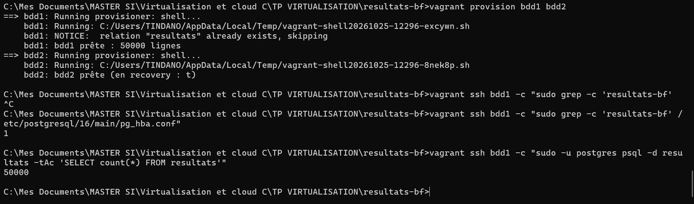
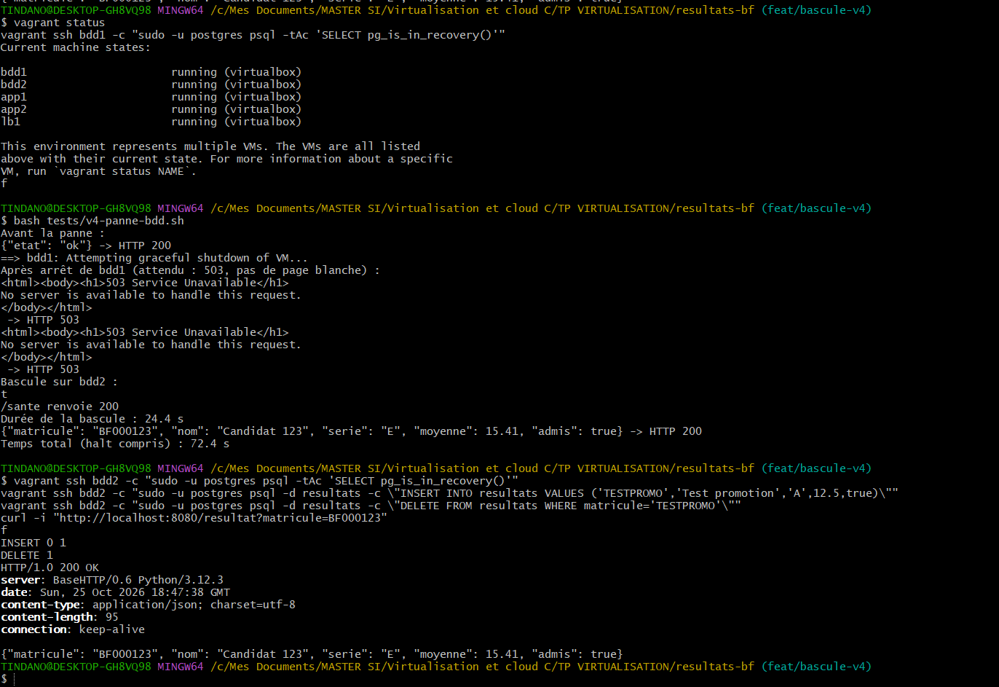
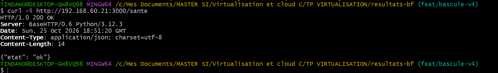

# Procédure de bascule de la base de données (scénario V4)

Auteur : TINDANO Fernand Amed, ingénieur données.   Date des essais : 25/10/2026.   Poste : réseau 192.168.60.0/24 (GROUPE=5).
Les sorties sont celles relevées sur le poste de l'auteur (captures du 25/10/2026), recopiées sans retouche.

---

## 1. Principe

La plateforme garde deux bases PostgreSQL : **bdd1**, primaire (lecture et écriture), et **bdd2**, réplique en flux (lecture seule). Quand bdd1 tombe, on **promeut bdd2** en primaire. Les applications n'ont rien à reconfigurer : chacune se connecte avec `DB_HOSTS=bdd1,bdd2` et `target_session_attrs=read-write`, donc la bibliothèque cliente écarte automatiquement une base en lecture seule et choisit celle qui accepte les écritures.

La bascule est **manuelle** (décision humaine), pour éviter que deux bases se croient primaires en même temps (split-brain). Le script `scripts/bascule.sh` refuse de promouvoir bdd2 tant que bdd1 tourne encore, et refuse si bdd2 est arrêtée.

## 2. Ce qui est en place

| Élément | Réalisation |
|---------|-------------|
| Réplication | Flux (streaming) : bdd2 est créée par `pg_basebackup -R -X stream` depuis bdd1 (`scripts/replique.sh`) |
| Paramètres de bdd1 | `wal_level = replica`, `max_wal_senders = 10`, `wal_keep_size = 256MB`, `hot_standby = on`, écoute sur `0.0.0.0` |
| Accès réplication | Utilisateur dédié `REPL_USER`, règle `pg_hba` limitée au réseau du groupe, authentification `scram-sha-256` |
| Secrets | Mots de passe lus depuis `.env` (jamais versionné), transmis par variables d'environnement |
| Idempotence | Rôles et données recréés seulement s'ils manquent ; le bloc `pg_hba` n'est ajouté qu'une fois ; bdd2 n'est initialisée qu'une seule fois (fichier marqueur), pour qu'un `vagrant provision` après bascule n'écrase pas la nouvelle primaire |

## 3. Vérifications avant la panne

Commandes :
```
vagrant ssh bdd1 -c "sudo -u postgres psql -d resultats -tAc 'SELECT count(*) FROM resultats'"
vagrant ssh bdd2 -c "sudo -u postgres psql -tAc 'SELECT pg_is_in_recovery()'"
vagrant ssh bdd1 -c "sudo -u postgres psql -c 'SELECT client_addr, state FROM pg_stat_replication'"
```
Sortie brute :
```
50000
t
 client_addr  |   state
--------------+-----------
 192.168.60.32 | streaming
(1 row)
```
Commentaire : bdd1 contient les 50 000 lignes, bdd2 est bien en recovery (`t`, donc réplique) et bdd1 la voit en état `streaming` : la réplication est active.


**Reste à refaire pour R5** : le test d'écriture sur bdd1 puis de lecture sur bdd2 (`bash tests/r5-replication.sh`). Lors de cet essai, le script a été lancé depuis l'invite de commandes Windows et n'a rien affiché après « Lecture sur bdd2 : » (voir la section 9). À relancer dans Git Bash.

## 4. Idempotence des scripts de données (R2)

Commandes :
```
vagrant provision bdd1 bdd2
vagrant ssh bdd1 -c "sudo grep -c 'resultats-bf' /etc/postgresql/16/main/pg_hba.conf"
vagrant ssh bdd1 -c "sudo -u postgres psql -d resultats -tAc 'SELECT count(*) FROM resultats'"
```
Sortie brute :
```
bdd1: NOTICE:  relation "resultats" already exists, skipping
bdd1: bdd1 prête : 50000 lignes
bdd2: bdd2 prête (en recovery : t)
1
50000
```
Commentaire : après un rejeu complet, le bloc `pg_hba` n'apparaît qu'une fois (`1`), le nombre de lignes n'a pas bougé (50 000) et bdd2 est restée une réplique. Le message `NOTICE` est normal : la table existe déjà.



## 5. Procédure de bascule pas à pas

**Attention : la bascule est irréversible.** Une fois bdd2 promue, seule une reconstruction complète (`vagrant destroy -f` puis `vagrant up`) remet la plateforme dans l'état initial.

Dans Git Bash, depuis la racine du dépôt :

1. Vérifier l'état avant la panne :
```
curl -s -w ' -> HTTP %{http_code}\n' http://localhost:8080/sante
```
Attendu : `{"etat": "ok"} -> HTTP 200`.

2. Simuler la panne de la base primaire :
```
vagrant halt bdd1
```
3. Constater l'effet côté service (attendu : 503, pas de page blanche) :
```
curl -s -w ' -> HTTP %{http_code}\n' http://localhost:8080/sante
```
4. Promouvoir bdd2 et chronométrer la reprise :
```
bash scripts/bascule.sh
```
Le script vérifie que bdd2 tourne et que bdd1 est arrêtée, promeut bdd2 si elle est encore en recovery (`pg_promote`), puis interroge `/sante` jusqu'au retour d'un 200 (60 s maximum, sinon il échoue avec un message). Il affiche la durée de la bascule.

5. Contrôler après la bascule :
```
vagrant ssh bdd2 -c "sudo -u postgres psql -tAc 'SELECT pg_is_in_recovery()'"
vagrant ssh bdd2 -c "sudo -u postgres psql -d resultats -c \"INSERT INTO resultats VALUES ('TESTPROMO','Test promotion','A',12.5,true)\""
vagrant ssh bdd2 -c "sudo -u postgres psql -d resultats -c \"DELETE FROM resultats WHERE matricule='TESTPROMO'\""
curl -i "http://localhost:8080/resultat?matricule=BF000123"
```
Attendu : `f`, puis `INSERT 0 1`, `DELETE 1`, et un 200 avec le JSON du candidat.

Le script `tests/v4-panne-bdd.sh` enchaîne les étapes 1 à 4 et mesure le temps total.

## 6. Résultats mesurés (V4)

### Essai 1

Commande : `bash tests/v4-panne-bdd.sh`, puis les contrôles de l'étape 5.

Sortie brute :
```
Avant la panne :
{"etat": "ok"} -> HTTP 200
==> bdd1: Attempting graceful shutdown of VM...
Après arrêt de bdd1 (attendu : 503, pas de page blanche) :
<html><body><h1>503 Service Unavailable</h1>
No server is available to handle this request.
</body></html>
 -> HTTP 503
<html><body><h1>503 Service Unavailable</h1>
No server is available to handle this request.
</body></html>
 -> HTTP 503
Bascule sur bdd2 :
t
/sante renvoie 200
Durée de la bascule : 24.4 s
{"matricule": "BF000123", "nom": "Candidat 123", "serie": "E", "moyenne": 15.41, "admis": true} -> HTTP 200
Temps total (halt compris) : 72.4 s
```
Contrôles après la bascule :
```
f
INSERT 0 1
DELETE 1
HTTP/1.0 200 OK
{"matricule": "BF000123", "nom": "Candidat 123", "serie": "E", "moyenne": 15.41, "admis": true}
```
Contrôle direct sur app1 (sans répartiteur), après la bascule :
```
$ curl -i http://192.168.60.21:3000/sante
HTTP/1.0 200 OK
Date: Sun, 25 Oct 2026 18:51:20 GMT
Content-Type: application/json; charset=utf-8
Content-Length: 14

{"etat": "ok"}
```





### Essai 2 (après `vagrant destroy -f` puis `vagrant up`)

Sortie brute (extrait de la fin) :
```
Avant la panne :
{"etat": "ok"} -> HTTP 200
==> bdd1: Attempting graceful shutdown of VM...
Après arrêt de bdd1 (attendu : 503, pas de page blanche) :
<html><body><h1>503 Service Unavailable</h1>
No server is available to handle this request.
</body></html>
 -> HTTP 503
<html><body><h1>503 Service Unavailable</h1>
No server is available to handle this request.
</body></html>
 -> HTTP 503
Bascule sur bdd2 :
t
/sante renvoie 200
Durée de la bascule : 26.4 s
{"matricule": "BF000123", "nom": "Candidat 123", "serie": "E", "moyenne": 15.09, "admis": true} -> HTTP 200
Temps total (halt compris) : 73.2 s
```


### Synthèse

| Mesure | Essai 1 | Essai 2 |
|--------|---------|---------|
| `/sante` avant la panne | 200 | 200 |
| `/sante` et `/resultat` bdd1 arrêtée, via le répartiteur | 503 (x2) | 503 (x2) |
| Durée de la bascule (`scripts/bascule.sh`) | 24,4 s | 26,4 s |
| Temps total, `vagrant halt` compris | 72,4 s | 73,2 s |
| `pg_is_in_recovery()` sur bdd2 après la bascule | `f` | non relevé |
| Écriture sur bdd2 après la bascule | `INSERT 0 1`, `DELETE 1` | non relevée |
| `/resultat` après la bascule | 200 | 200 |

Moyenne de la durée de bascule : environ 25,4 s sur deux essais.

Commentaire : la panne de la base primaire se traduit par un **503 propre** (c'est la page d'erreur de HAProxy, car aucun serveur applicatif n'est jugé sain), jamais par une page blanche ni une erreur de connexion brute. Après promotion de bdd2, le service revient seul, sans toucher aux applications, et bdd2 accepte les écritures (contrôle de l'essai 1). Les deux essais donnent des durées proches (24,4 s et 26,4 s). L'écart entre le temps total et la durée de bascule (environ 48 s) s'explique vraisemblablement par l'arrêt de la machine par `vagrant halt` (arrêt propre puis forcé), la pause de 5 s et les requêtes de contrôle ; cette décomposition n'a pas été chronométrée.

## 7. Limites connues

| Limite | Conséquence | Piste |
|--------|-------------|-------|
| bdd1 n'est pas remise en réplique après la bascule | Après V4, il n'y a plus de réplique : la plateforme n'est plus redondante | Reconstruire bdd1 en réplique de bdd2 (`pg_basebackup`), ou reconstruire toute la plateforme |
| bdd1 reste la première base essayée par les applications | Tant qu'elle est éteinte, chaque connexion devrait attendre son délai de 2 s avant d'utiliser bdd2 (non mesuré après la bascule) | Ré-ordonner `DB_HOSTS` après la bascule, ou placer un répartiteur de base devant les deux serveurs |
| La réplication est asynchrone | À la panne brutale de bdd1, les dernières transactions pas encore envoyées à bdd2 peuvent être perdues (non mesuré) | Réplication synchrone, au prix de la latence d'écriture |
| La bascule est manuelle | Le service reste indisponible tant que personne ne lance le script | Outil de bascule automatique (par exemple Patroni), hors périmètre du projet |
| Le 503 vient de HAProxy en HTML | Le corps de la réponse n'est pas du JSON | Personnaliser la page d'erreur HAProxy |
| La durée de 24 à 26 s n'est pas décomposée | On ignore la part due à `vagrant ssh` (lent sous Windows), à la promotion et au rétablissement des sondes HAProxy | Chronométrer chaque étape séparément |
| Les données sont aléatoires | `BF000123` vaut 15,41 puis 15,09 après une reconstruction sur le même poste, et d'autres valeurs chez d'autres membres | Fixer la graine (`setseed`) dans `scripts/bdd.sh` |

## 8. Ce que nous ferions autrement

Automatiser la remise en réplique de l'ancienne primaire, décomposer la durée de la bascule étape par étape, et répéter chaque mesure au moins trois fois.

## 9. Précautions d'utilisation (incidents des essais)

- Les scripts `tests/*.sh` et `scripts/bascule.sh` doivent être lancés dans **Git Bash**. Lancés par `bash` depuis l'invite de commandes Windows, ils échouent avec `vagrant: command not found`, affichent `HTTP 000`, et `bascule.sh` répond à tort « bdd2 n'est pas démarrée ». Ces essais n'ont aucune valeur de mesure.
- Un essai interrompu de téléchargement de la boîte laisse une archive tronquée (`Truncated tar archive`) : relancer `vagrant up` reprend le téléchargement.
