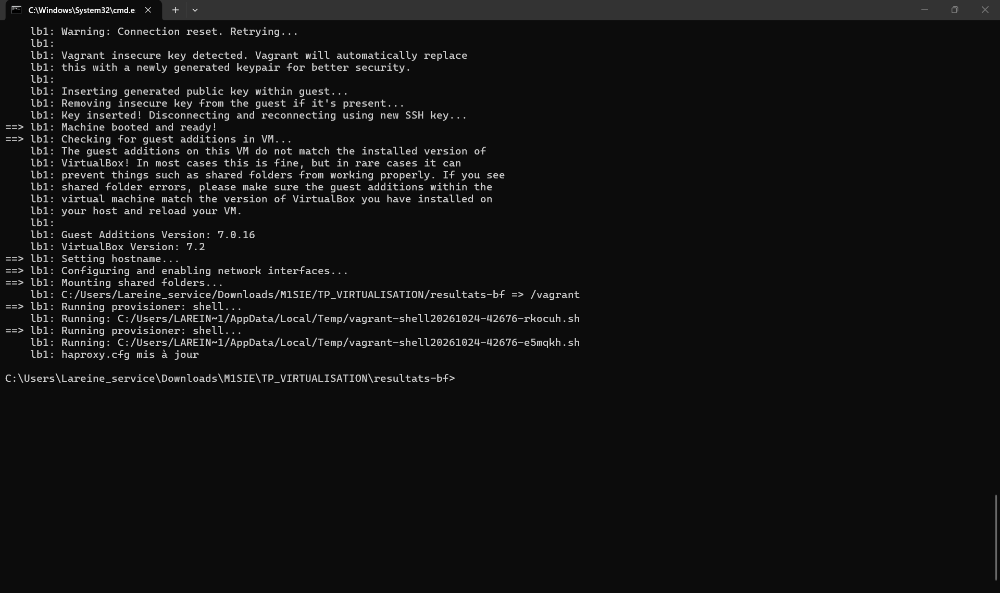
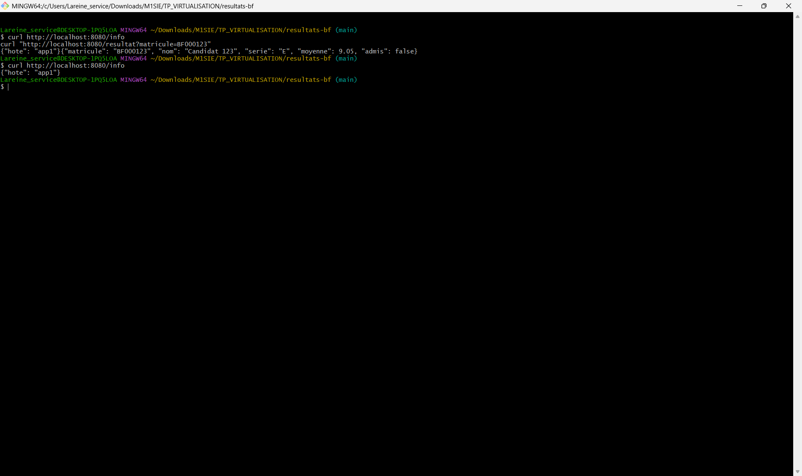
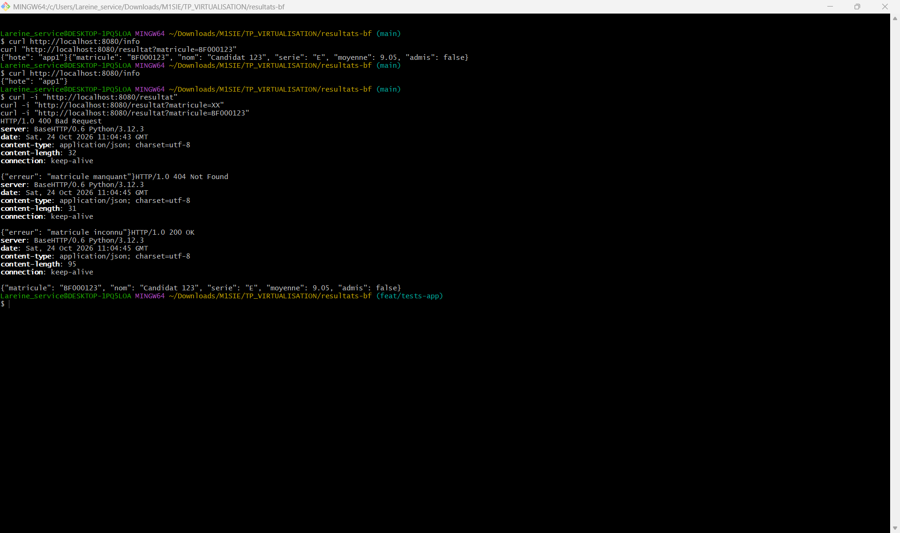
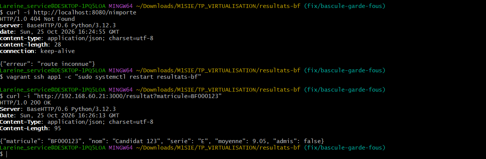
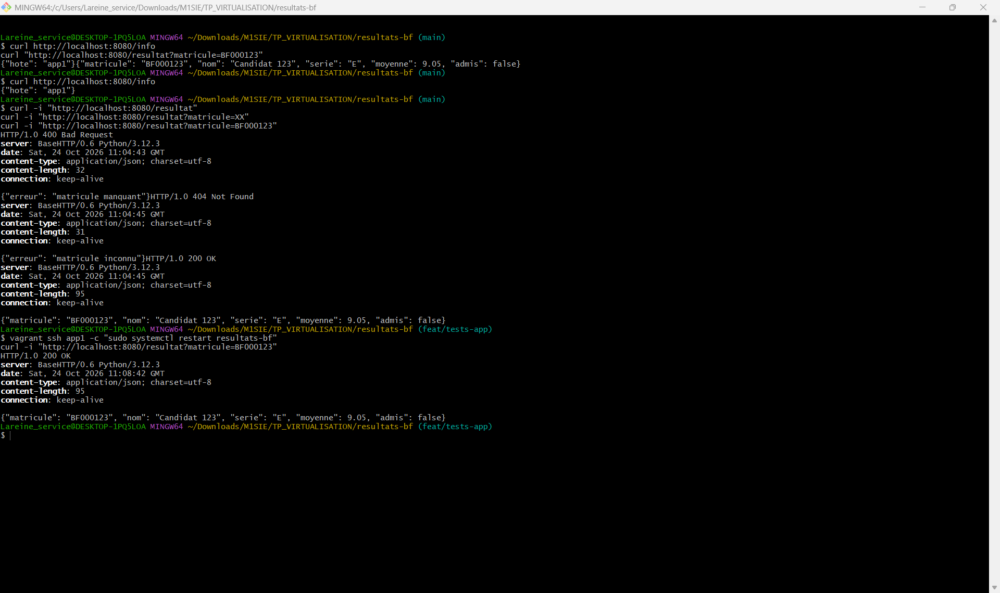
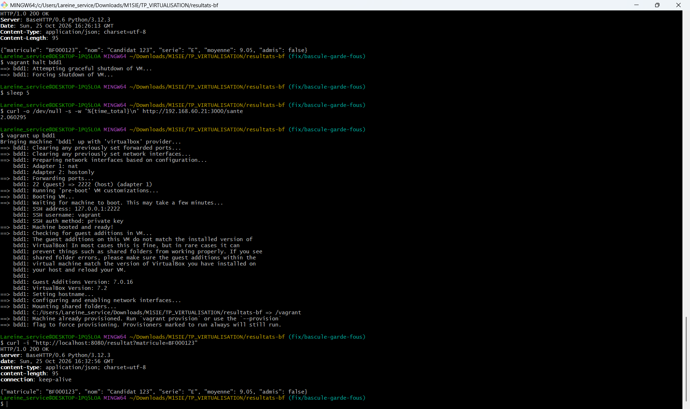
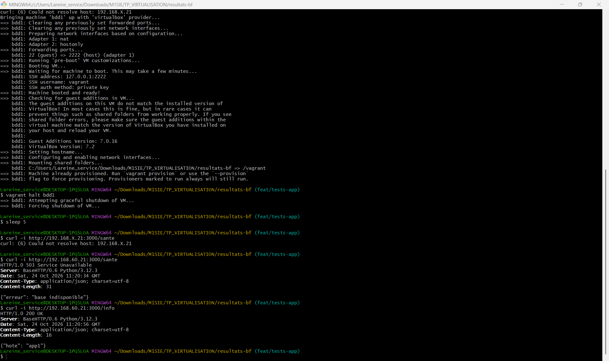
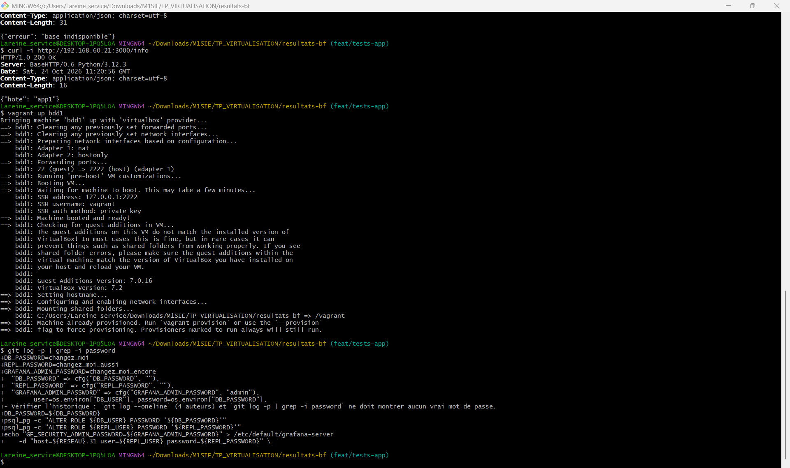

# Tests de l'application (ingénieur applicatif)

Auteur : Lareine TEGA   Date : 24/10/2026   Poste : ___ (CPU, RAM)   GROUPE (.env) : 5 (réseau 192.168.60.0/24)

Les sorties ci-dessous sont celles relevées sur le poste de l'auteur (captures d'écran du 24/10/2026), recopiées sans retouche.
Statut : T1 à T7 réalisés (T4, T5 en test direct et le temps de T6 relevés le 25/10/2026). Seule la vérification complémentaire de T7 (`.env` non suivi par Git) reste à faire.

## Démarrage de la plateforme





---

## T1. Matricule manquant

Commande :
```
curl -i "http://localhost:8080/resultat"
```
Attendu : `400` et `{"erreur": "matricule manquant"}`

Sortie brute :
```
HTTP/1.0 400 Bad Request
server: BaseHTTP/0.6 Python/3.12.3
date: Sat, 24 Oct 2026 11:04:43 GMT
content-type: application/json; charset=utf-8
content-length: 32
connection: keep-alive

{"erreur": "matricule manquant"}
```
Commentaire : conforme. L'application refuse proprement une requête incomplète, avec un JSON explicite.

## T2. Matricule inconnu

Commande :
```
curl -i "http://localhost:8080/resultat?matricule=XX"
```
Attendu : `404` et `{"erreur": "matricule inconnu"}`

Sortie brute :
```
HTTP/1.0 404 Not Found
server: BaseHTTP/0.6 Python/3.12.3
date: Sat, 24 Oct 2026 11:04:45 GMT
content-type: application/json; charset=utf-8
content-length: 31
connection: keep-alive

{"erreur": "matricule inconnu"}
```
Commentaire : conforme. La base répond, mais aucune ligne ne correspond : l'application distingue ce cas d'une panne (503).

## T3. Matricule valide

Commande :
```
curl -i "http://localhost:8080/resultat?matricule=BF000123"
```
Attendu : `200` et un JSON avec `matricule`, `nom`, `serie`, `moyenne`, `admis`

Sortie brute :
```
HTTP/1.0 200 OK
server: BaseHTTP/0.6 Python/3.12.3
date: Sat, 24 Oct 2026 11:04:45 GMT
content-type: application/json; charset=utf-8
content-length: 95
connection: keep-alive

{"matricule": "BF000123", "nom": "Candidat 123", "serie": "E", "moyenne": 9.05, "admis": false}
```
Commentaire : conforme. Les cinq champs de la table `resultats` sont présents et `admis` est cohérent avec la moyenne (9,05 inférieure à 10).



## T4. Route inconnue

Commande :
```
curl -i http://localhost:8080/nimporte
```
Attendu : `404` et `{"erreur": "route inconnue"}`

Sortie brute :
```
HTTP/1.0 404 Not Found
server: BaseHTTP/0.6 Python/3.12.3
date: Sun, 25 Oct 2026 16:24:55 GMT
content-type: application/json; charset=utf-8
content-length: 28
connection: keep-alive

{"erreur": "route inconnue"}
```
Commentaire : conforme. Une route qui n'existe pas reçoit une erreur 404 en JSON, comme les autres erreurs : l'application ne renvoie jamais de page d'erreur brute.



## T5. Absence d'état : redémarrage d'un serveur applicatif

Commandes :
```
vagrant ssh app1 -c "sudo systemctl restart resultats-bf"
curl -i "http://localhost:8080/resultat?matricule=BF000123"
```
Attendu : la réponse revient immédiatement, identique à T3, sans autre action.

Sortie brute :
```
HTTP/1.0 200 OK
server: BaseHTTP/0.6 Python/3.12.3
date: Sat, 24 Oct 2026 11:08:42 GMT
content-type: application/json; charset=utf-8
content-length: 95
connection: keep-alive

{"matricule": "BF000123", "nom": "Candidat 123", "serie": "E", "moyenne": 9.05, "admis": false}
```
Commentaire : la réponse est identique à T3. **Limite de ce test** : la requête passe par le répartiteur, qui peut l'avoir confiée à app2 plutôt qu'à app1. Pour prouver que app1 redémarrée répond aussitôt, refaire le test directement sur app1 :
```
vagrant ssh app1 -c "sudo systemctl restart resultats-bf"
curl -i "http://192.168.60.21:3000/resultat?matricule=BF000123"
```
Sortie brute du test direct :
```
$ vagrant ssh app1 -c "sudo systemctl restart resultats-bf"
$ curl -i "http://192.168.60.21:3000/resultat?matricule=BF000123"
HTTP/1.0 200 OK
Server: BaseHTTP/0.6 Python/3.12.3
Date: Sun, 25 Oct 2026 16:26:13 GMT
Content-Type: application/json; charset=utf-8
Content-Length: 95

{"matricule": "BF000123", "nom": "Candidat 123", "serie": "E", "moyenne": 9.05, "admis": false}
```
Commentaire du test direct : cette fois la requête vise le port 3000 d'app1, sans répartiteur. Le serveur redémarré répond aussitôt avec les mêmes données : il ne conserve aucun état local, tout est relu dans la base.



## T6. Base absente : `/sante` renvoie 503 proprement

Commandes :
```
vagrant halt bdd1
sleep 5
curl -i http://192.168.60.21:3000/sante
curl -i http://192.168.60.21:3000/info
vagrant up bdd1
```
Attendu : `/sante` en 503 avec un JSON, jamais une page blanche ; `/info` en 200 (cette route ne touche pas la base).

Sortie brute :
```
$ vagrant halt bdd1
==> bdd1: Attempting graceful shutdown of VM...
==> bdd1: Forcing shutdown of VM...
$ sleep 5
$ curl -i http://192.168.60.21:3000/sante
HTTP/1.0 503 Service Unavailable
Server: BaseHTTP/0.6 Python/3.12.3
Date: Sat, 24 Oct 2026 11:20:34 GMT
Content-Type: application/json; charset=utf-8
Content-Length: 31

{"erreur": "base indisponible"}
$ curl -i http://192.168.60.21:3000/info
HTTP/1.0 200 OK
Server: BaseHTTP/0.6 Python/3.12.3
Date: Sat, 24 Oct 2026 11:20:56 GMT
Content-Type: application/json; charset=utf-8
Content-Length: 16

{"hote": "app1"}
```
Commentaire : conforme. Quand la base primaire est arrêtée, l'application répond 503 avec un message JSON, et `/info` reste à 200. C'est la sonde que lit le répartiteur : un 503 fait retirer le serveur du service.

Incident de manipulation (sans lien avec l'application) : une première exécution a utilisé l'adresse littérale `192.168.X.21` (`curl: (6) Could not resolve host`), car le X n'avait pas été remplacé par 60. Le test a été refait avec la bonne adresse.

Temps de réponse de `/sante` avec la base arrêtée (mesure du 25/10/2026) :
```
$ vagrant halt bdd1
$ sleep 5
$ curl -o /dev/null -s -w '%{time_total}\n' http://192.168.60.21:3000/sante
2.060295
```
Soit environ **2,06 s**. Ce délai correspond au `connect_timeout=2` de l'application : elle attend deux secondes la base avant de répondre 503. Après `vagrant up bdd1`, `curl -i "http://localhost:8080/resultat?matricule=BF000123"` répond de nouveau `200` : la plateforme est revenue sans autre action.





## T7. Aucun secret dans l'historique Git (R7)

Commande :
```
git log -p | grep -i password
```
Attendu : uniquement des noms de variables ou la valeur factice `changez_moi`.

Sortie brute :
```
+DB_PASSWORD=changez_moi
+REPL_PASSWORD=changez_moi_aussi
+GRAFANA_ADMIN_PASSWORD=changez_moi_encore
+  "DB_PASSWORD" => cfg("DB_PASSWORD", ""),
+  "REPL_PASSWORD" => cfg("REPL_PASSWORD", ""),
+  "GRAFANA_ADMIN_PASSWORD" => cfg("GRAFANA_ADMIN_PASSWORD", "admin"),
+        user=os.environ["DB_USER"], password=os.environ["DB_PASSWORD"],
+- Vérifier l'historique : `git log --oneline` (4 auteurs) et `git log -p | grep -i password` ne doit montrer aucun vrai mot de passe.
+DB_PASSWORD=${DB_PASSWORD}
+psql_pg -c "ALTER ROLE ${DB_USER} PASSWORD '${DB_PASSWORD}'"
+psql_pg -c "ALTER ROLE ${REPL_USER} PASSWORD '${REPL_PASSWORD}'"
+echo "GF_SECURITY_ADMIN_PASSWORD=${GRAFANA_ADMIN_PASSWORD}" > /etc/default/grafana-server
+    -d "host=${RESEAU}.31 user=${REPL_USER} password=${REPL_PASSWORD}" \
```
Commentaire : aucun vrai mot de passe. Les mots de passe passent par des variables (`${DB_PASSWORD}`, `os.environ[...]`) et `.env.exemple` ne contient que des valeurs factices. Un point à noter : le Vagrantfile utilise `"admin"` comme valeur par défaut du mot de passe Grafana, si `.env` n'en définit pas. Ce n'est pas un secret réel, mais c'est un mot de passe faible par défaut.

Vérification complémentaire : `git ls-files | grep -x .env` ne doit rien afficher. _à faire_



---

## Anomalies constatées et propositions

| Test | Constat | Proposition |
|------|---------|-------------|
| T3 | `moyenne` de BF000123 vaut 9,05 sur ce poste, alors que le poste d'Adama affiche 19,73 | Les 50 000 lignes sont engendrées avec `random()` : les données diffèrent à chaque reconstruction. Pour des mesures reproductibles, fixer la graine (`SELECT setseed(0.42);` avant l'INSERT de `scripts/bdd.sh`) |
| T5 | Le premier test passait par le répartiteur et ne prouvait pas qu'app1 répondait | Résolu : test refait directement sur `192.168.60.21:3000` (200) |
| T7 | Mot de passe Grafana par défaut `"admin"` dans le Vagrantfile | Exiger la variable dans `.env` ou supprimer la valeur par défaut |

## Conclusion

Les trois codes d'erreur de l'application (400, 404, 503) sont conformes à l'attendu, et la réponse JSON est toujours propre. Le serveur ne garde aucun état local, et la base absente est signalée par `/sante` sans que `/info` en souffre. Un `/sante` en 503 met environ 2 s à répondre quand la base est arrêtée (délai de connexion de 2 s) : c'est la limite à citer dans le dossier. Reste à faire : vérifier avec `git ls-files | grep -x .env` que le fichier `.env` n'est pas suivi par Git.
